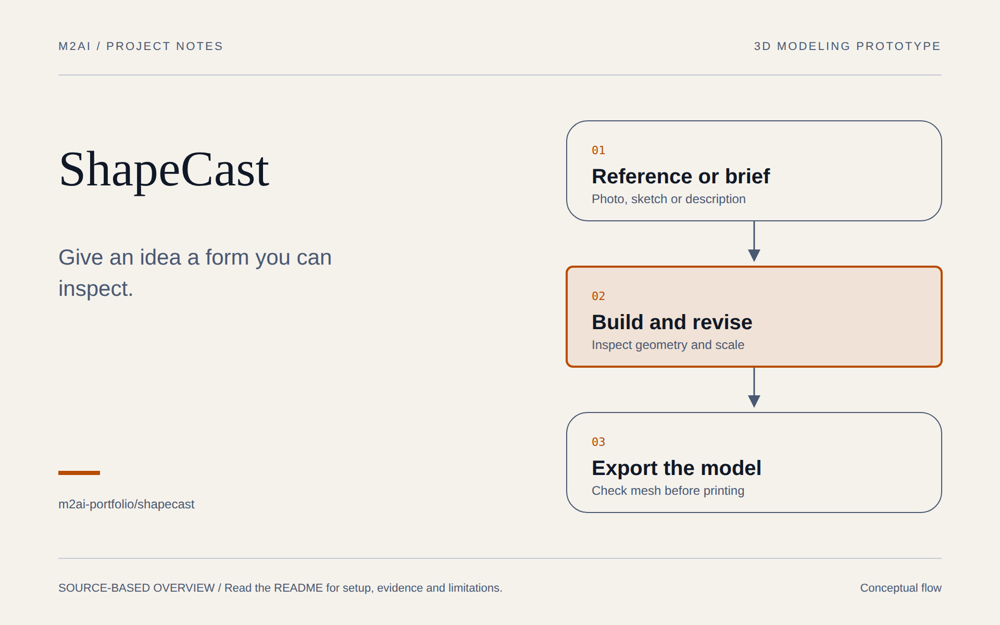
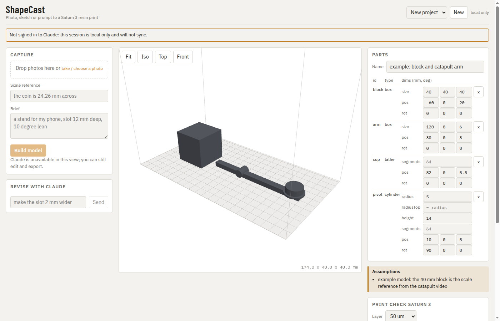

# ShapeCast Studio



A reference image is not yet a printable object. ShapeCast explores the steps between an idea and a resin-print candidate: describe the shape, establish scale, inspect the model, revise parts and export geometry for slicing.

The repository contains two related implementations: a browser editor originally built for the Claude artifact runtime, and a separate Mesh Forge service for generated meshes and Blender processing. Its practical value is the iteration workflow and explicit geometry checks. An exported STL is a candidate for slicer review, not proof of a successful physical print.

## A recorded editor view



This is the checked-in local preview from 3 October 2026. Its visible notice states that Claude is unavailable; it demonstrates the editor layout and example geometry, not successful live generation.

## What is here

- An editable primitive-model workflow with a Three.js viewport, dimensions, part checks and a Saturn 3 export bundle.
- Model schema validation, triangle and byte limits, manifold checks and printer-volume checks.
- A `forge/` TypeScript service with MCP/HTTP interfaces, authentication, jobs, ComfyUI workflow files and a Blender post-processing script.
- Historical acceptance records that distinguish a brief-only artifact build from blocked image capabilities and partial cross-device validation.

## Build and inspect the editor

Use Node.js and npm. The repository does not declare a Node engine; choose a version compatible with the checked-in dependency lockfile.

```bash
git clone https://github.com/m2ai-portfolio/shapecast
cd shapecast
npm ci
npm run typecheck
npm test
npm run lint
npm run build
npm run fixture
```

The build inlines `src/*.js` into `src/page.html` and writes `index.html`. The fixture command produces `tests/fixtures/chitubox-acceptance.zip`. Neither command establishes that a live model generation or print succeeded.

Open the built HTML in a browser to inspect the interface. Generation, persistence and downloads depend on the selected runtime capabilities or a configured Forge connection. A plain HTML preview does not reproduce all the artifact platform's `sample`, `downloads`, `db`, `assets` and `user` capabilities. Some frontend libraries load from a CDN.

## First walkthrough

1. Start with the generated fixture ZIP and inspect its STL files in your slicer. Check scale, build-volume fit, overlap layers and orientation before considering a print.
2. Review the editor's parts table and geometry checks. In a configured runtime, enter a simple brief with an explicit reference dimension, inspect the result, change a dimension and review the updated checks.
3. Export only after the geometry checks pass and the runtime provides downloads. Open the resulting ZIP in your slicer and independently assess supports, hollowing and resin-print suitability.
4. Compare your results with [the dated acceptance record](docs/acceptance/2026-10-03-publish.md). Its October artifact test could build from text, but photo input was blocked by that account's runtime. Do not treat a selected image thumbnail as proof of photo-to-model generation.

## Optional Mesh Forge development

Forge has its own dependencies and build. From the repository root:

```bash
cd forge
npm ci
npm run build
npm run typecheck
npm test
```

Before starting it, inspect [the server entry point](forge/src/server.ts) and configure `FORGE_PUBLIC_URL`, `FORGE_CLIENT_ID`, `FORGE_CLIENT_SECRET` and `FORGE_OWNER_PASSPHRASE`. Supply values through your existing secure environment; on ProBook load `~/.env.shared` first. Set `FORGE_COMFY_URL` to your own ComfyUI service rather than relying on the author's LAN default. `FORGE_HOST` and `FORGE_PORT` control the listener; OAuth state is stored under `~/.local/state/shapecast-forge/`.

`npm start` in `forge/` runs the built server. Generated-mesh workflows additionally depend on a suitable GPU host, the models and nodes referenced in `forge/workflows/`, and Blender compatible with the checked-in processing script. Inspect these prerequisites before running a generation. Building the service alone does not install those components or configure a provider.

## Verification and limits

The test suite covers geometry, validation, lifecycle and other code behavior. The acceptance log records a historical slicer check and partial cross-device save/reopen evidence. It does not establish arbitrary object accuracy, photo support on every runtime, dependable generated-mesh completion or a physical print.

The published artifact referenced in the acceptance log was private. Use the public source and fixtures for review rather than assuming that old artifact link is publicly accessible.

## Layout

| File                  | Role                                                                       |
| --------------------- | -------------------------------------------------------------------------- |
| `src/schema.js`       | part-list validator, limits, triangle and byte budgets                     |
| `src/geometry.js`     | primitives to triangles, transforms, manifold checks, analytic volumes     |
| `src/printcheck.js`   | Saturn 3 build-volume, feature size, contact graph, overhang, layer counts |
| `src/stl.js`          | binary STL writer                                                          |
| `src/lifecycle.js`    | request tokens (stale replies) and generation-based autosave               |
| `src/prompts.js`      | builder and editor prompts for Claude                                      |
| `src/exportbundle.js` | slug and README text for the export zip                                    |
| `src/model.js`        | field edits, image preparation, document size guards, sample model         |
| `src/viewport.js`     | Three.js scene with a true-size Saturn 3 plate                             |
| `src/app.js`          | DOM glue, capabilities, persistence                                        |
| `docs/platform/`      | vendored artifact runtime type definitions (contract 0.2.67)               |

## Acceptance gates (manual)

1. Phase 0 probe on the Pixel and the Surface (`docs/acceptance/*-phase0.md`).
2. Chitubox slice of `tests/fixtures/chitubox-acceptance.zip` on AlienPC: every overlap region
   must slice solid (`docs/acceptance/*-chitubox.md`).
3. After publish: one `ArtifactData` read of `data/users/<uid>/workspace/projects` after a save,
   one real photo-to-print run, one cross-device reopen.
